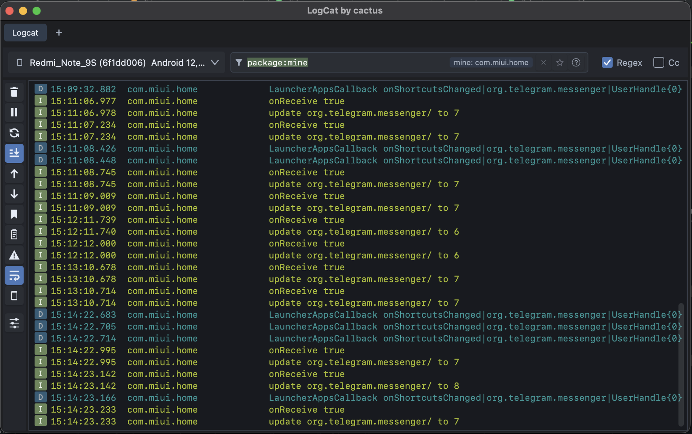

# LogCat by cactus

Android Logcat вне Android Studio и внутри неё. Два проекта в одном репозитории:



| Каталог | Что это |
|---|---|
| [`LogCactus/`](LogCactus) | Десктопное приложение (Kotlin + Compose Multiplatform, macOS и Windows): вкладки с независимыми сессиями, язык фильтра (`tag:`, `level:`, `package:mine`, `age:`, `is:crash`), краши и ANR, закладки, баг-репорт, Wi-Fi ADB, встроенный adb/aapt2 |
| [`LogCactusPlugin/`](LogCactusPlugin) | Плагин для Android Studio с тем же языком фильтра. UI — на Jewel/Compose самой IDE; общая логика подключается из `LogCactus/` как исходники (`syncShared`), поэтому репозиторий нужно клонировать целиком |

Документация (на русском): [`docs/`](docs), история изменений — [`CHANGELOG.md`](CHANGELOG.md).

English in one line: a standalone desktop Logcat viewer (Compose Desktop) plus an Android Studio plugin sharing one filter engine; docs are in Russian.

## Быстрый старт

Приложение (JDK 17):

```bash
cd LogCactus
./gradlew run          # нужен adb в PATH или встроенный (по умолчанию используется встроенный)
./gradlew test
./gradlew packageDmg   # macOS;  gradlew.bat packageMsi — Windows
```

Плагин (JDK 21, локальная Android Studio):

```bash
cd LogCactusPlugin
./gradlew test buildPlugin -PstudioPath="/Applications/Android Studio.app"
```

Подробности и параметры — в `LogCactus/README.md` и `LogCactusPlugin/README.md`.

## Подпись и публикация

Секретов в репозитории нет. Подпись macOS-сборки включается свойством `-PmacSignIdentity`, подпись и публикация плагина — переменными окружения `CERTIFICATE_CHAIN`, `PRIVATE_KEY`, `PRIVATE_KEY_PASSWORD`, `PUBLISH_TOKEN`.

## Лицензия

[Apache License 2.0](LICENSE). Сторонние компоненты — в [`NOTICE`](NOTICE).
